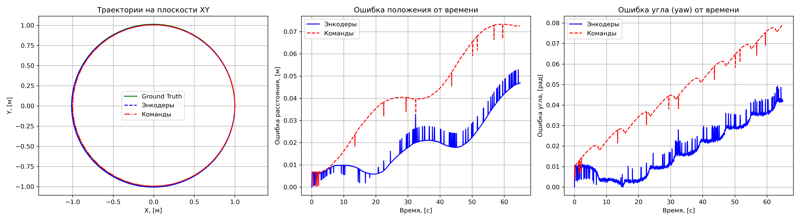
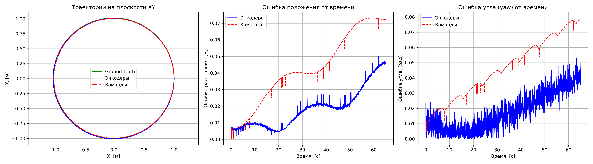
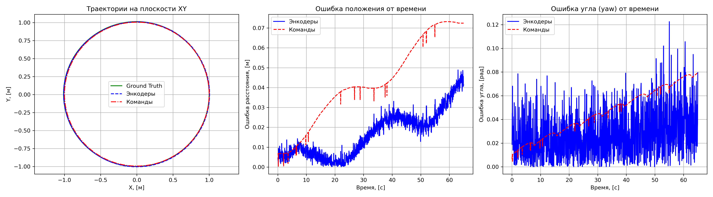

* **Студент:** Узяев Анвар
* **Вариант:** 16 (старт в точке x=1, y=0, yaw=pi/2; скорости v=0.2, w=0.2)


---

## запуск

### 1. сервер Webots на Mac
в терминале Mac:
```bash
python3 /Users/anvar/Downloads/local_simulation_server.py
```

### 2. запуск контейнера
в терминале Ubuntu:
```bash
cd ~/mobile-robots-project-seminar
HOST_XAUTHORITY="$XAUTHORITY" docker compose --env-file .env --env-file .env.local -f docker-compose.yaml -f docker-compose.gpu.yaml -f docker-compose.webots-mac.yaml up -d
```

### 3. вход в контейнер
```bash
HOST_XAUTHORITY="$XAUTHORITY" docker compose --env-file .env --env-file .env.local -f docker-compose.yaml -f docker-compose.gpu.yaml -f docker-compose.webots-mac.yaml exec -it ros2-base zsh
```

### 4. сброс кэша и сборка (внутри контейнера)
```bash
cd ~/practices_ws
rm -rf build install log
colcon build --packages-select practice_03 --symlink-install
source install/setup.zsh
```

### 5. запуск
```bash
ros2 launch practice_03 spawn_robot.launch.py
```

---

## смена шума

Шум энкодеров меняется в файле `practices/practice-03/worlds/my_world.wbt` в параметре `encoderNoise`:
* `encoderNoise 0`
* `encoderNoise 0.02`
* `encoderNoise 0.1`

---

## Графики

### Шум 0


### Шум 0.02


### Шум 0.1


---

## Выводы

1. При отсутствии шума колесная одометрия едет очень близко к истине (ошибка всего 4-5 см за 2 круга).
2. Одометрия по командам накапливает ошибку сильнее около 7 см, потому что она считает идеальное движение и не учитывает физику симулятора и задержки.
3. При добавлении шума `encoderNoise 0.1` на графике угла yaw у энкодеров сразу появляется сильный шум амплитудой около 0.1 рад. На координатах XY шум тоже виден, но общая траектория круга все равно сохраняется.

