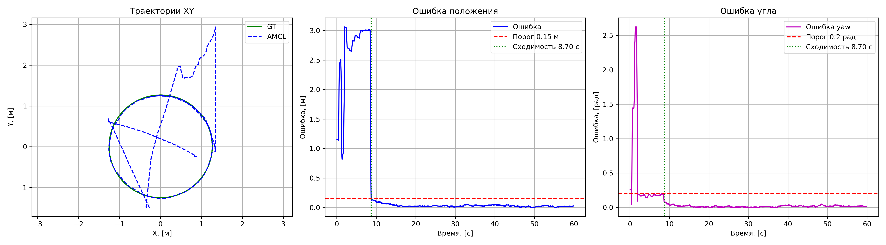
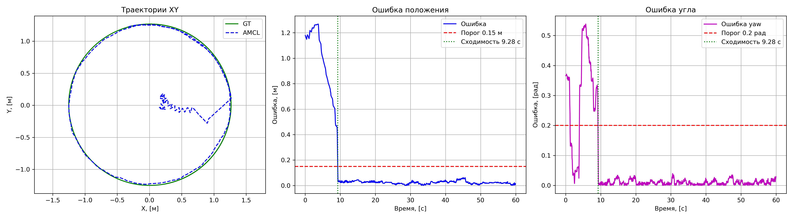
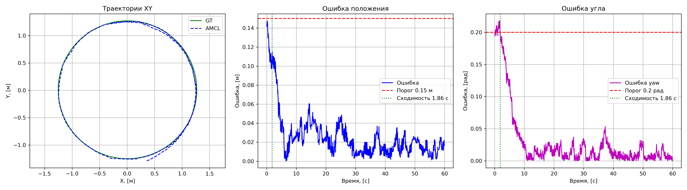
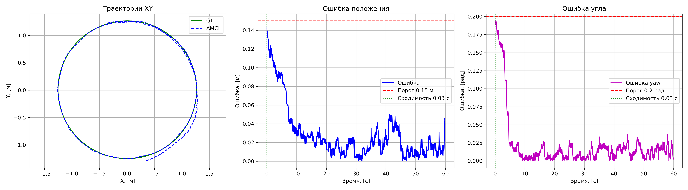
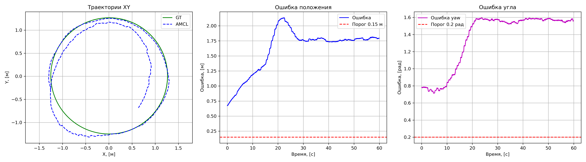
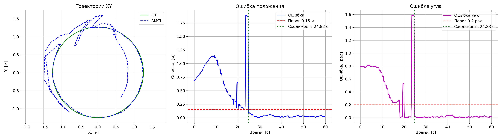

# Практика 4. Локализация по известной карте

Узяев Анвар, вариант 16 


## сборка
```bash
colcon build --packages-select practice_04 --symlink-install
source install/setup.zsh
```

## команды запуска экспериментов
1. глобальная 800:
ros2 launch practice_04 spawn_robot.launch.py localization_mode:=global max_particles:=800 output_path:=/home/anvar/mobile-robots-project-seminar/practices/practice-04/results/1_global_few.png

2. глобальная 10000:
ros2 launch practice_04 spawn_robot.launch.py localization_mode:=global max_particles:=10000 output_path:=/home/anvar/mobile-robots-project-seminar/practices/practice-04/results/2_global_many.png

3. малая ошибка 800:
ros2 launch practice_04 spawn_robot.launch.py localization_mode:=initial error_x:=0.15 error_y:=-0.10 error_yaw:=0.20 max_particles:=800 output_path:=/home/anvar/mobile-robots-project-seminar/practices/practice-04/results/3_initial_small_few.png

4. малая ошибка 10000:
ros2 launch practice_04 spawn_robot.launch.py localization_mode:=initial error_x:=0.15 error_y:=-0.10 error_yaw:=0.20 max_particles:=10000 output_path:=/home/anvar/mobile-robots-project-seminar/practices/practice-04/results/4_initial_small_many.png

5. большая ошибка 800:
ros2 launch practice_04 spawn_robot.launch.py localization_mode:=initial error_x:=0.50 error_y:=0.40 error_yaw:=0.80 max_particles:=800 output_path:=/home/anvar/mobile-robots-project-seminar/practices/practice-04/results/5_initial_big_few.png

6. большая ошибка 10000:
ros2 launch practice_04 spawn_robot.launch.py localization_mode:=initial error_x:=0.50 error_y:=0.40 error_yaw:=0.80 max_particles:=10000 output_path:=/home/anvar/mobile-robots-project-seminar/practices/practice-04/results/6_initial_big_many.png

пороги брал: ошибка положения 0.15 м, ошибка угла 0.2 рад, окно подтверждения 5 с, время 60 с.

## результаты

| № | режим | начальная ошибка | max particles | время сходимости, с |
|---|---|---|---|---|
| 1 | глобальная | - | 800 | 8.70 |
| 2 | глобальная | - | 10000 | 9.28 |
| 3 | initial | малая (0.15, -0.10, 0.20) | 800 | 1.86 |
| 4 | initial | малая (0.15, -0.10, 0.20) | 10000 | 0.03 |
| 5 | initial | большая (0.50, 0.40, 0.80) | 800 | не сошлась (>60) |
| 6 | initial | большая (0.50, 0.40, 0.80) | 10000 | 24.83 |

## графики

### эксп 1


### эксп 2


### эксп 3 


### эксп 4 


### эксп 5 


### эксп 6 


## выводы
с начальной догадкой если ошибка небольшая сходится почти сразу (0.03-1.86 с), при глобальной надо проехать пару метров чтобы лидар понял где робот (около 9 с)
при большой ошибке 800 частиц не хватило вообще и amcl улетел в ложный минимум и не сошелся за минуту, а с 10000 частиц робот сошелся за 24.8 с
